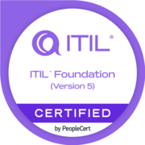

### Studyfor5:
---
<a href="https://studyfor5.com">
  <picture>
    <source media="(prefers-color-scheme: dark)" srcset="https://studyfor5.com/branding/logo-dark.svg">
    
  </picture>
</a>

Founded [Studyfor5](https://studyfor5.com), an AP prep platform with auto-graded FRQ practice, midterm and full mock exams, CED-aligned lessons and practice quizzes, AP score predictions, and more. Currently available for AP Chemistry and AP Calculus.

### Experience:
---
 
 
 
 
 
 
 
 

### Certifications:
---
 

 

 

### Other Projects:
---
- **[Auto Tee Time Booker](https://github.com/MacDylan73/python_projects/blob/main/auto%208AM%20tee%20time%20booker.py)** – Automatically books 8AM tee times at a local golf course
- **[USCB B104 Final Project](https://github.com/MacDylan73/B104-final-project)** – Python programming and data analysis final project
<!-- - **[USCB B320 Final Project](https://github.com/MacDylan73/REPO-NAME)** – Relational database management and design final project -->
- **[USCB B409 Final Project](https://github.com/MacDylan73/B409-Axon-Body-Worn-Camera-Evidence-Management-System-NIST-Security-Review)** – Enterprise risk management final report: NIST SP 800-37 security review of an Axon body-worn camera evidence management system, with network diagram
